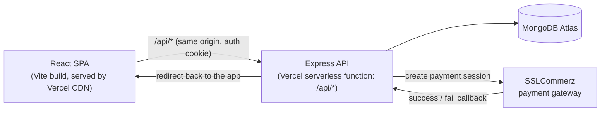

# ARONNOK - Rare Hybrid Plants Marketplace 🌱

A full-stack e-commerce platform to explore, buy, sell and **bid on** rare hybrid plants, with an admin dashboard for managing products, orders, auctions and sell requests. Built as part of the Software Development Sessional.

**🔗 [Live demo](https://aronnok.vercel.app)**  · **🎬 [Demo video](https://youtu.be/D6CSEQouq4Q)**

> **Try it without signing up:** the login page has one-click **Try as shopper** and **Try as admin** buttons.
> (Demo accounts: `demo` / `demo1234` and `admin` / `admin123`.)

<!-- Add a screenshot or GIF here, e.g.  -->

## 🚀 Features

**Shoppers**
- Browse trending, new-arrival, recommended and coming-soon plants; search by name
- Cart and checkout with the **SSLCommerz** payment gateway (sandbox)
- **Live auctions**: upcoming, ongoing and completed auctions with countdowns and bidding
- Submit plants to sell, or to be listed in an upcoming auction
- Favourites, wishlist, ratings, order history and order-status tracking
- In-app notifications (e.g. when you win an auction)

**Admins**
- Dashboard with sales graph, best sellers, active orders and user count
- Manage products and categories, create auctions, review auction and sell requests
- Manage orders (update status) and view user profiles and purchase history

## 🛠️ Tech stack

| Layer | Technology |
|---|---|
| Frontend | React 18, React Router 7, Vite, Chart.js, react-slick |
| Backend | Node.js, Express 5 |
| Database | MongoDB with Mongoose |
| Auth | JWT in an httpOnly cookie, bcrypt password hashing, role-based access control |
| Payments | SSLCommerz |
| Testing / CI | `node:test` + Supertest + mongodb-memory-server, GitHub Actions |
| Hosting | Vercel (static frontend + serverless Express function) |

## 🏗️ Architecture



Frontend and API share one origin, so the httpOnly auth cookie works without any CORS setup. In development, Vite proxies `/api` to the local Express server, so the setup is the same.

## 💻 Run it locally

Requirements: Node.js 20.19+ (see `.nvmrc`) and a MongoDB database (a free [MongoDB Atlas](https://www.mongodb.com/atlas) cluster or a local `mongod`).

```bash
git clone https://github.com/saeha303/Aronnok.git
cd Aronnok

# 1. Install dependencies (API + frontend)
npm install
npm install --prefix frontend

# 2. Configure environment variables
cp .env.example .env        # then fill in DATABASE, SECRET, ...

# 3. Load demo data (plants, auctions, demo accounts)
npm run seed

# 4. Start the API (http://localhost:8000) and, in another terminal, the frontend
npm run dev
npm run client
```

Open http://localhost:5173.

### Environment variables

| Variable | Description |
|---|---|
| `DATABASE` | MongoDB connection string |
| `SECRET` | Secret used to sign login tokens (any long random string) |
| `APP_URL` | Public URL of the app, used for payment redirects (`http://localhost:5173` locally) |
| `CORS_ORIGINS` | Extra origins allowed to call the API (only needed if the frontend is hosted elsewhere) |
| `SSLCOMMERZ_STORE_ID`, `SSLCOMMERZ_STORE_PASSWORD` | [SSLCommerz sandbox](https://developer.sslcommerz.com/registration/) credentials |
| `SSLCOMMERZ_IS_LIVE` | `false` for sandbox |
| `SEED_ADMIN_PASSWORD`, `SEED_DEMO_PASSWORD` | Optional: override the demo account passwords when seeding |

### Tests

```bash
npm test
```

These tests start an in-memory MongoDB and cover signup and login, password hashing (including upgrading old hashes), and per-route access control (owner, admin, anonymous).

## ☁️ Deploy to Vercel

1. Create a free MongoDB Atlas cluster. Under Network Access, allow `0.0.0.0/0`, since Vercel's IP addresses change.
2. Run `npm run seed` locally with `DATABASE` pointing at that cluster.
3. Import the GitHub repo in Vercel. `vercel.json` already sets the install command, build command, output directory and rewrites.
4. Add the environment variables above in **Project → Settings → Environment Variables**. Set `APP_URL` to your Vercel URL, e.g. `https://aronnok.vercel.app`, and set `NODE_ENV=production`.
5. Deploy.

## 📁 Project structure

```
├── api/index.js          # Vercel serverless entry (wraps the Express app)
├── app.js                # Express app (also runs standalone with `npm start`)
├── controller/           # Route handlers
├── models/               # Mongoose schemas
├── routes/               # API routes + auth middleware wiring
├── scripts/seed.js       # Demo data
├── test/                 # API tests
└── frontend/             # React + Vite single-page app
    └── src/
        ├── Pages/        # Route-level pages (lazy-loaded)
        ├── Components/   # Reusable UI components
        ├── Context/      # React context providers
        ├── backend.js    # API base URL
        └── session.js    # Signed-in user helpers
```

## 🔭 What I'd improve next

- Real-time bidding over WebSockets instead of polling
- Image uploads to object storage (e.g. Cloudinary or Vercel Blob) instead of picking from bundled images
- A consistent responsive design system across all pages
- Frontend component and end-to-end tests

## 👥 Contributors

- Sumaiya Saeha Charu (1905033)
- Fariha Zaman Aurin (1905049)
- Debjany Ghosh Aronno (1905053)

<!-- Tip for your portfolio: add a short "My contributions" section listing the parts you built. -->
